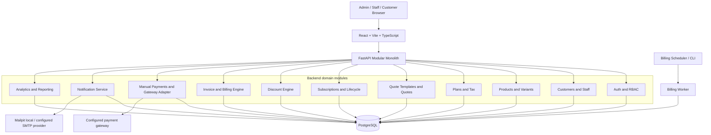

# Brightloop Subscription Management System — Engineering Implementation Guide (v2)

**Prepared from:** `Subscription_Management_System.pdf` and the user's confirmed decisions / uploaded hackathon criteria screenshots  
**Target:** Demo-ready, end-to-end MVP by **31 October 2026, 4:00 PM IST**  
**Team:** 2 human developers, assisted by Cursor, Antigravity, Codex and GitHub Copilot  
**Repository rule:** One shared GitHub repository and one branch only (use `main`)  
**Document status:** Updated implementation blueprint. Assumptions that still need business approval are explicitly called out.

---

## 0. Decisions that are now locked

| Area | Confirmed decision |
|---|---|
| Frontend | React + Vite + TypeScript |
| UI system | shadcn/ui, styled/customized with tweakcn; responsive and consistent design |
| Backend | FastAPI + Python |
| Database | PostgreSQL |
| Architecture | Modular monolith; do not split into microservices for this submission |
| Local/offline approach | Local-first: core application works locally; internet is needed only for external email and payment services |
| Pricing | Product base price plus multiple additive variant adjustments; no separate usage-based pricing model has been requested |
| Renewals | Automatic renewals; billing date follows the subscription start-date anchor using calendar-aware intervals |
| Plan switch | Equal-value plan: no adjustment. Upgrade: charge the price difference. Downgrade: recommended to take effect at next renewal |
| Quote conversion | Customer can view/accept quotation in portal; acceptance confirms the quotation/subscription flow |
| Tax | Generic configurable tax rules plus India GST support (CGST, SGST, IGST as configured) |
| Discounts | Product-specific and subscription-wide, with thresholds and usage limits; no stacking; choose the eligible rule yielding the highest saving |
| Payments | Manual recording and payment gateway support; manual recording is fully functional first |
| Notifications | Password reset, invoice delivery, quotation delivery, renewal reminders and overdue reminders; local development email mode plus configurable provider |
| Dashboard | All metrics required by PDF plus MRR, ARR, total invoices and upcoming renewals |
| Team | 2 people; one monitored branch only |
| Coding agents | Cursor = primary integrator; Antigravity = UI/browser testing; Codex = backend/domain logic and review; Copilot = inline coding assistance |
| Submission | Working application plus recorded functionality walkthrough video |

### What the Docker Compose + GitHub setup means

Yes. Docker Compose configuration is committed to GitHub with the source code. Another developer can clone the repo, install Docker Desktop/Engine, copy `.env.example` to `.env`, and run `docker compose up --build`. They get the same web app, API, PostgreSQL database and worker locally. GitHub stores the files; it does **not** run the containers automatically just because the repository is pushed.

The first build normally needs internet to download base images and dependencies. After those are cached, the core local stack can run without internet. Local email should use a development mail catcher such as Mailpit. Real email delivery and a live payment gateway require internet and provider credentials. Never commit `.env`, API keys, payment secrets, SMTP passwords, database dumps containing real customer data, or production credentials.

---

## 1. Product objective and submission target

Brightloop currently tracks subscriptions in spreadsheets, remembers renewals manually, types invoices, matches payments against bank statements and builds revenue reports manually. The system should centralize the subscription-business lifecycle:

1. Customer registration and secure access.
2. Admin-managed products, variants, plans, taxes, discounts and quotation templates.
3. Quotation creation and customer acceptance.
4. Subscription confirmation, activation, pause, renewal and closure.
5. Automatic recurring invoice generation.
6. Invoice confirmation, cancellation, delivery and printing.
7. Manual payment allocation first, with a gateway adapter available.
8. Payment, overdue and recurring-revenue reporting.

**4 PM acceptance target:** A reviewer can use the application from a clean local setup and demonstrate the full happy path using database-backed records. All core forms must validate, the UI must be responsive, billing must be idempotent, customer records must be isolated, and no critical data should depend on hardcoded JSON. Static JSON is allowed only for temporary visual prototyping or non-business demo fixtures; it must not act as the live source of truth.

A demo-ready MVP is not the same as production-ready financial software. Keep external provider credentials, tax/accounting sign-off, backup/restore verification, security review and load testing as explicit release gates.

---

## 2. Requirement provenance

### 2.1 Requirements from the original PDF

- Registration with unique email, password longer than eight characters, uppercase, lowercase and special character; password reset by email.
- Admin, internal staff and customer access roles. Only admin can create staff.
- Product name/type/sales price/cost price/notes and variants with price additions (example: Odoo +560).
- Plans with price, daily/weekly/monthly/yearly frequency, minimum quantity, availability dates and plan-specific auto-close, early-close, pause and renewal rules.
- Quote templates with plan/product lines and validity duration.
- Subscription number, customer, plan, start/expiry dates, payment terms, product/quantity/unit price/tax/amount lines and lifecycle Draft → Quotation → Confirmed → Active → Closed.
- Automatic invoices created from due subscriptions; invoice actions confirm/cancel/send/print; workflow Draft → Confirmed → Paid.
- Configurable tax calculation.
- Fixed or percentage discount, minimum purchase/quantity, start/end date, use cap, product/subscription scope and automatic invoice application.
- Payment method, amount, date and note recorded against the correct invoice.
- Dashboard for active subscriptions, revenue, payments and overdue invoices, with filters.
- Under-two-second page response with thousands of subscriptions.

### 2.2 Additional hackathon criteria from the screenshots

**Must-have:** dynamic/live data rather than static JSON; responsive clean UI; consistent color/layout; robust input validation; intuitive navigation and spacing; proper collaborative Git usage.  
**Nice-to-have:** backend API/data-model/database design; understand and adapt AI-generated code; local/offline capability; use technology only where it adds value.  
**Submission rule:** the team leader submits the GitHub repository link; code must be present in a single repository branch.

### 2.3 User-confirmed additions

The decisions table in Section 0 is part of the agreed specification. Where the PDF and later decisions differ in detail, apply the later user-confirmed business rules while retaining every original PDF capability.

---

## 3. Recommended stack and why

| Layer | Technology | Implementation notes |
|---|---|---|
| Frontend | React + Vite + TypeScript | SPA, fast local dev server, strict types |
| Components | shadcn/ui | Copy-in components that remain editable in the repo |
| Theme | tweakcn + Tailwind CSS variables | Define tokens once; use one consistent theme across admin/staff/customer layouts |
| Forms | React Hook Form + Zod | Client-side feedback; do not replace server validation |
| API client | TanStack Query + typed fetch/Axios wrapper | Query caching, loading/error state and invalidation |
| Backend | Python + FastAPI + Pydantic | REST API, request validation and modular routers |
| ORM | SQLAlchemy 2 | Explicit transactions and relationships |
| Migrations | Alembic | Versioned schema changes; never rely on manual DB edits |
| Database | PostgreSQL | Unique constraints, foreign keys, transactions and row locking |
| Billing worker | Separate process using same FastAPI domain package | Worker can be invoked repeatedly and safely |
| Email dev mode | Mailpit (or equivalent local SMTP catcher) | Inspect password reset, quotation, invoice and reminder emails locally |
| Payment | Provider adapter + manual payment module | Manual payment is required for MVP; gateway provider can be configured later |
| Runtime | Docker Compose | Reproducible local app + DB + worker + email catcher |
| Tests | Pytest, HTTPX, Vitest, React Testing Library, Playwright | Unit, API, UI and end-to-end workflow tests |

Do not add Redis, Kafka, Kubernetes, microservices or a complex workflow engine unless a real requirement emerges. PostgreSQL can coordinate the first billing worker using transactions and row locks.

---

## 4. System architecture



### 4.1 Runtime units

- **web:** React frontend; static assets served from a container or local Vite server.
- **api:** FastAPI HTTP process.
- **db:** PostgreSQL with a named Docker volume.
- **worker:** scheduled billing process; uses the same code and database as the API.
- **mailpit:** optional local email inbox for development and video demonstration.

The modular monolith means one API application with clearly separated domain modules. The worker is a separate process, not a separate microservice/domain deployment.

### 4.2 Repository structure

```text
brightloop-subscription-management/
├── apps/
│   ├── web/
│   │   ├── src/
│   │   │   ├── app/                 # Router, providers, protected layouts
│   │   │   ├── components/          # Shared shadcn/ui wrappers
│   │   │   ├── features/
│   │   │   │   ├── auth/
│   │   │   │   ├── dashboard/
│   │   │   │   ├── customers/
│   │   │   │   ├── products/
│   │   │   │   ├── plans/
│   │   │   │   ├── quotations/
│   │   │   │   ├── subscriptions/
│   │   │   │   ├── taxes/
│   │   │   │   ├── discounts/
│   │   │   │   ├── invoices/
│   │   │   │   └── payments/
│   │   │   ├── lib/                 # API client, utilities, formatters
│   │   │   └── styles/
│   │   └── Dockerfile
│   └── api/
│       ├── app/
│       │   ├── main.py
│       │   ├── core/                # Config, DB, auth, permissions
│       │   ├── modules/
│       │   │   ├── auth/
│       │   │   ├── users/
│       │   │   ├── customers/
│       │   │   ├── products/
│       │   │   ├── plans/
│       │   │   ├── taxes/
│       │   │   ├── quotations/
│       │   │   ├── subscriptions/
│       │   │   ├── discounts/
│       │   │   ├── invoices/
│       │   │   ├── payments/
│       │   │   ├── notifications/
│       │   │   └── analytics/
│       │   └── workers/
│       ├── alembic/
│       ├── tests/
│       └── Dockerfile
├── infra/
│   ├── compose.yaml
│   └── scripts/
├── docs/
│   ├── PRD.md
│   └── demo-script.md
├── .env.example
├── .gitignore
├── AGENTS.md
└── README.md
```

Do not split the product into frontend repositories, backend repositories or separate branches. Keep everything in the single team repository and the single required branch.

---

## 5. Database design

Use UUID primary keys internally and human-readable immutable codes for subscriptions, quotations and invoices. Store money as `NUMERIC(14,2)` (or suitable configured precision), never floating point. Store timestamps in UTC; format for the configured business timezone in the UI. Currency is a configurable organization setting; do not hardcode symbols in business logic.

### 5.1 Core tables

| Table | Important columns |
|---|---|
| `users` | `id`, `email_normalized` UNIQUE, `password_hash`, `role`, `is_active`, `customer_id` nullable, `created_at` |
| `customers` | `id`, `customer_code`, `name`, `email`, phone, billing address, state, country, GSTIN nullable, status |
| `products` | `id`, `name`, `type`, `sales_price`, `cost_price`, `currency`, `notes`, `is_active` |
| `product_variants` | `id`, `product_id`, `attribute_name`, `option_name`, `price_delta`, `is_active` |
| `plans` | `id`, `name`, `price`, `currency`, `interval_unit`, `interval_count`, `min_quantity`, `available_from`, `available_until`, `auto_renew`, `auto_close`, `allow_early_close`, `allow_pause`, `allow_renew` |
| `tax_rules` | `id`, `name`, `tax_kind` (generic/CGST/SGST/IGST/other), `rate`, `inclusive`, `jurisdiction/state`, `effective_from`, `effective_to`, `is_active` |
| `quote_templates` | `id`, `name`, `validity_days`, `default_plan_id`, `is_active` |
| `quote_template_lines` | `id`, `template_id`, `product_id`, variant selections, quantity, price snapshot, tax assignment |
| `quotations` | `id`, `quote_number` UNIQUE, `customer_id`, `template_id`, `valid_until`, `status`, subtotal, discount, tax, total, accepted_at |
| `quotation_lines` | quote, product/variant, quantity, unit price snapshot, tax snapshot, amount |
| `subscriptions` | `id`, `subscription_number` UNIQUE, customer, plan, start date, expiry date, next billing date, status, payment terms, auto-renew, billing anchor, current cycle, pause metadata |
| `subscription_lines` | subscription, product/variants, quantity, unit price snapshot, tax assignment, amount |
| `subscription_events` | subscription, event type, from/to status, actor, timestamp, metadata |
| `plan_change_events` | subscription, old plan, new plan, effective date, old normalized value, new normalized value, adjustment amount, invoice link |
| `discount_rules` | `id`, name, kind (fixed/percentage), value, min purchase, min quantity, starts_at, ends_at, max_uses, used_count, priority, active, scope |
| `discount_targets` | discount rule, product_id nullable (null can mean whole subscription) |
| `discount_redemptions` | rule, invoice, amount_saved, created_at; unique rule/invoice if policy requires one redemption |
| `invoices` | `id`, `invoice_number` UNIQUE, `subscription_id`, customer snapshot, billing period start/end, issue/due date, workflow status, subtotal, discount, tax, total, amount_paid, outstanding, idempotency_key UNIQUE |
| `invoice_lines` | invoice, product snapshot, quantity, unit price, tax name/rate/amount, discount allocation, line total |
| `payments` | `id`, invoice_id, method, amount, currency, payment_date, note, recorded_by, source (manual/gateway), provider_reference nullable, status |
| `payment_webhook_events` | provider, provider_event_id UNIQUE, payload hash, received_at, processed_at, status |
| `notification_outbox` | type, recipient, template, payload, status, attempts, last_error, sent_at |
| `billing_runs` | start/end time, processed/generated/skipped/failed counts, status, error summary |
| `audit_logs` | actor, action, entity type/id, timestamp, before/after JSON, request metadata |

### 5.2 Essential indexes and constraints

- Unique index on `lower(trim(email))` or stored normalized email.
- Unique `subscription_number`, `quote_number`, `invoice_number`.
- Unique `invoices.idempotency_key` and/or `(subscription_id, period_start, period_end)`.
- Index on `subscriptions(status, next_billing_at)` for due billing.
- Indexes on `invoices(status, due_date)`, `payments(payment_date)`, subscription customer/status and invoice customer/date.
- Foreign keys with restrictive delete semantics for financial history.
- Positive quantity, nonnegative prices, positive payment amounts; all rules validated again on backend.
- One atomic transaction for invoice, lines, discount redemption, usage counter and subscription billing-date advancement.
- Gateway event IDs must be unique so a provider webhook cannot create the same payment twice.

### 5.3 Historical snapshots

A product price, plan price, tax rule or discount rule can change later. Existing quotations, subscriptions and invoices must not silently mutate. Copy the effective unit price, tax name/rate/amount, discount amount, customer billing identity and currency into quote/invoice snapshots. Amendments create new versions/events, not a rewrite of old invoices.

---

## 6. Business logic and calculations

### 6.1 Registration and authentication

1. Normalize email by trimming whitespace and applying consistent case handling.
2. Enforce unique email in PostgreSQL, not just in a pre-insert query.
3. Password must be **at least 9 characters** and include uppercase, lowercase and special character, because the PDF says more than eight characters.
4. Hash with Argon2id (preferred) or bcrypt; never store plaintext.
5. Public registration always creates a `CUSTOMER`; it cannot set `ADMIN` or `STAFF`.
6. Only an authenticated admin can invite/create a staff account.
7. Reset tokens are random, single-use, expiring, stored hashed and delivered through the notification adapter.
8. Protect login/reset endpoints with rate limits and generic responses to avoid account enumeration.

### 6.2 Product variants (confirmed option B)

A product has one base sales price and may have multiple variant attributes/options. Each selected variant adds its configured delta.

```text
unit_price = product_base_price + sum(selected_variant.price_delta)
line_subtotal = unit_price * quantity
```

Example: base price ₹2,000; selected brand adds ₹560; another selected storage variant adds ₹300; final unit price = ₹2,860; quantity 3 gives a pre-tax line subtotal of ₹8,580. This is an illustration, not a fixed product. Validate that all chosen options belong to the product. No independent per-seat/usage-metered pricing model was selected; quantity remains available on lines.

### 6.3 Plan billing and renewal

- Support daily, weekly, monthly and yearly frequencies.
- Plans renew automatically by default, subject to plan configuration and a valid subscription status.
- Use the subscription start date as the billing anchor. Do not compute monthly as 30 days or yearly as 365 days.
- Example: a monthly subscription starting on the 31st should retain a predictable month-end anchor; use the last valid day in shorter months and return to the original anchor when possible.
- Yearly schedules preserve month/day where possible; handle leap-day subscriptions with a documented fallback (recommended: 28 February in non-leap years).
- `next_billing_at` is stored and indexed, derived from start date and interval, then advanced one period only after invoice generation commits.
- Pause stops invoice generation. On resume, recommended MVP policy: shift the next billing date by the pause duration and record the change; do not silently create catch-up invoices for paused periods.
- If `auto_close=true`, close at expiry after final eligible period; otherwise alert staff before expiry and wait for permitted action.
- Early close, pause and manual renewal must check the plan's relevant flags. The plan's auto-renew setting is explicit; if false, do not renew automatically.

### 6.4 Plan change / upgrade / downgrade

Confirmed user policy:

- Switching to another plan with the same monetary value creates **no extra charge**.
- Switching to a higher-value plan charges the difference.
- Cancellation does **not** stop service immediately; the subscription continues until its expiry date.

Implementation policy used for the MVP (two items below are assumptions, not explicitly specified by the user):

1. Compare the new and old recurring plan values on a normalized monthly recurring basis for the same quantity, before tax and before one-time add-ons. This avoids comparing a monthly price directly with an annual price.
2. Equal-value switch: apply the new plan immediately, record a plan-change event, and create no adjustment invoice.
3. Upgrade: apply the new plan immediately and create a one-time adjustment invoice line equal to the full positive difference. **No time proration is applied in the current assumption.** Next recurring invoice uses the new full plan price.
4. Downgrade: queue it for the next renewal; current paid period remains unchanged and no immediate credit/refund is issued.
5. Cancellation request: record `cancel_at_period_end=true`; keep subscription active through `expiry_at`; stop future renewal after expiry and then close. An admin may override only through an audited operation if business rules allow.

Before production, confirm whether upgrade difference should be full or time-prorated and whether downgrades should ever generate credits.

### 6.5 Quotation and customer acceptance

- Staff selects a template and customer; system copies plan/product lines and price/tax snapshots.
- `valid_until = issued_at + validity_days` using the organization business timezone.
- Customer portal displays quotation details, validity and total; customer can accept.
- Acceptance is recorded with timestamp, authenticated customer and terms/version reference. The system transitions the quote/subscription to Confirmed, then activates on `start_date`.
- Expired quotation cannot be accepted; staff must reissue or extend it and preserve the audit trail.

### 6.6 Taxes: generic rules + India GST

- Admin can configure generic taxes and GST-specific tax kinds including CGST, SGST and IGST; rate is stored as configuration, never hardcoded in source code.
- Customer billing state, seller/organization state, GSTIN where applicable, product/service classification and admin-configured place-of-supply decision can inform which tax rule applies.
- For an intra-state supply, configuration may apply CGST + SGST; for an inter-state supply, configuration may apply IGST. This rule must be reviewed against the actual transaction and applicable tax guidance before production use.
- Support inclusive/exclusive flag per tax rule or line where approved. Preserve tax name, type, rate and computed amount on invoice line snapshot.
- Tax calculation examples for exclusive percentages:

```text
line_taxable_value = line_subtotal - allocated_discount
CGST_amount = round(line_taxable_value * CGST_rate / 100, currency_precision)
SGST_amount = round(line_taxable_value * SGST_rate / 100, currency_precision)
IGST_amount = round(line_taxable_value * IGST_rate / 100, currency_precision)
invoice_total = subtotal - discount_total + tax_total
```

Do not infer live GST rates from product category; rates and jurisdiction mapping are admin configuration. A finance/tax reviewer must approve tax treatment, rounding and invoice fields before production.

### 6.7 Discount engine: highest eligible saving, no stacking

A discount can be fixed or percentage-based and may target one or more products or the whole subscription. It is eligible only when:

- Active and inside start/end dates.
- Usage count has not reached the configured cap.
- Minimum purchase amount and/or minimum quantity conditions are met.
- Product/subscription scope matches the invoice.

Calculation:

```text
percentage_discount = eligible_base * percentage / 100
fixed_discount = min(configured_fixed_amount, eligible_base)
```

Evaluate every eligible candidate, calculate the actual monetary saving it would produce for the invoice, and choose the candidate with the **highest saving amount**. Apply exactly one rule; do not stack. For a product-specific rule, calculate the discount only against matching product lines. For a subscription-wide rule, calculate it against the eligible subscription subtotal. When two rules yield exactly the same saving, use a stable tie-breaker (admin priority, then more specific product target, then rule ID). Record the winning rule and amount on the invoice. Increment usage count in the same transaction as invoice creation; lock or atomically claim capacity to prevent concurrent workers exceeding the cap.

**Open edge case:** if the winning discount is product-specific, compare its saving against a subscription-wide candidate before applying the one winner. Do not combine them.

### 6.8 Recurring invoice generation and idempotency

**Invariant:** one subscription has at most one invoice per billing period.

Worker sequence:

1. Find active subscriptions with `next_billing_at <= now` and not paused/cancelled-at-period-end/expired.
2. Claim a row using `SELECT ... FOR UPDATE SKIP LOCKED`.
3. Determine exact period start/end from the plan interval and anchor.
4. Build deterministic idempotency key `subscription:{id}:{period_start}:{period_end}`.
5. Check/insert the invoice under a unique constraint.
6. Snapshot customer, product, variant, quantity, unit price, discount and tax.
7. Update discount usage/redemption and `next_billing_at` inside the same transaction.
8. Commit, then enqueue invoice notification in an outbox.
9. On failure, roll back; record failure and retry safely.

Pseudocode:

```python
for candidate in find_due_subscriptions(now):
    with db.begin():
        sub = lock_subscription_skip_locked(candidate.id)
        if not sub or not is_billable(sub, now):
            continue
        period = determine_next_unbilled_period(sub)
        key = make_invoice_key(sub.id, period.start, period.end)
        if invoice_exists(key):
            reconcile_schedule_without_duplicate(sub, period)
            continue
        invoice = snapshot_invoice(sub, period)
        apply_highest_saving_discount(invoice)  # no stacking
        calculate_configured_taxes(invoice)
        db.add(invoice_with_key(invoice, key))
        record_discount_redemption_if_any(invoice)
        advance_next_billing_date(sub, period)
        enqueue_invoice_email(invoice)
```

The unique database constraint is the final defence; application checks alone are insufficient. Process overdue backlogs in bounded batches and show skipped/failed items in a billing-run view. Never silently skip a due cycle.

### 6.9 Invoice statuses, payments and overdue balances

Keep invoice workflow state and settlement state distinguishable:

- Workflow: Draft → Confirmed → Paid; cancellation is an allowed separate terminal state before settlement, subject to authorization.
- Settlement view: Unpaid, Partially paid, Paid, Overdue.
- Outstanding = `max(invoice_total - sum(successful_allocated_payments), 0)`.
- A confirmed invoice is overdue when due date is before current business date and outstanding > 0.
- Support multiple payment records against an invoice.
- Manual payment captures method, amount, date and note and is fully operational without internet.
- Do not accept an overpayment silently; reject or require an explicit admin-approved credit workflow.
- Payments are append-only or corrected through audited reversal/adjustment; do not silently delete financial history.

### 6.10 Payment gateway adapter

- Create a provider interface such as `PaymentGateway.create_checkout()`, `verify_webhook()` and `refund()` (refund may remain out of scope until approved).
- Do not store card numbers, CVV or sensitive payment credentials. Use provider-hosted checkout/tokenization.
- Store provider transaction/reference IDs and payment status only.
- Verify webhook signatures and deduplicate by provider event ID before recording a payment.
- User has not selected a provider yet. Keep provider-specific implementation behind an adapter; use sandbox credentials only for demo where available. Manual payments remain the reliable default.

### 6.11 Notifications: all five flows

Required types:

1. Password reset.
2. Invoice delivery.
3. Quotation delivery and acceptance link.
4. Upcoming renewal reminders.
5. Overdue payment reminders.

Use a notification outbox with retry, delivery status and error visibility. Development mode routes messages to Mailpit/local inbox and clearly labels the mode. Production mode uses a configurable SMTP/transactional provider. Do not claim an email was delivered merely because an outbox row was created. Renewal and overdue reminder cadence should be configurable; default demo cadence can be seeded but must be documented as a demo default.

---

## 7. Reporting and dashboard definitions

All widgets use one consistent filter state and server-side calculations. Do not conflate cash collection with accounting-recognized revenue.

| Metric | Definition |
|---|---|
| Active subscriptions | Count of subscriptions in Active state as of selected date |
| Revenue collected | Sum of successful payments received in selected period |
| Outstanding amount | Sum of positive balances on confirmed invoices |
| Overdue invoices | Count of confirmed invoices past due with outstanding > 0 |
| Overdue amount | Sum of outstanding balances on overdue invoices |
| Total payments | Count and sum of successful payments in selected period |
| Total invoices | Count of invoices under the current filter (also show date-range label) |
| MRR | Normalized monthly recurring value of active subscriptions, excluding tax and one-time charges |
| ARR | MRR × 12, or annualized recurring value using documented normalization |
| Upcoming renewals | Count/list of subscriptions with next billing/renewal date inside selected future window |

Filters: date range, customer, plan, product, subscription status, invoice status, payment method and overdue age bucket. MRR/ARR must be labeled estimates/run-rate, not statutory recognized revenue. Provide a visible definition tooltip or explanatory text.

---

## 8. Frontend pages and UI specification

### 8.1 Design direction

Use shadcn/ui components customized through tweakcn theme tokens. Avoid a large collection of unrelated component libraries. Establish typography, spacing, radius, surface, border, focus, primary, success, warning and destructive tokens before implementing feature pages.

**Required design standards:**

- Responsive layout for desktop, tablet and mobile widths.
- Consistent color scheme, typography, table density, spacing and component variants.
- Predictable sidebar/top navigation by role; active navigation state and clear page titles.
- Good placement of primary and secondary actions; destructive actions require confirmation.
- Forms show field-level messages and server validation errors.
- Every data page has loading, empty, error, success and retry states.
- Tables have search/filter, stable sort, pagination and readable status badges.
- Avoid modal overload; use side panels/dialogs for short create/edit tasks and dedicated detail pages for complex records.
- Do not put cost price, internal notes or admin finance data in customer-facing payloads.

### 8.2 Roles and primary navigation

**Admin:** Overview; Customers; Staff & Users; Products; Plans; Taxes; Discounts; Quote Templates; Quotations; Subscriptions; Invoices; Payments; Reports; Settings.  
**Staff:** Overview; Customers; Quotations; Subscriptions; Invoices; Payments; Renewal Queue; Overdue Queue. Catalog/tax/discount configuration is read-only or hidden unless explicitly granted.  
**Customer:** My Overview; My Quotations; My Subscriptions; My Invoices; Account & Security.

Role-based navigation improves usability only. Every route and API must enforce permissions server-side.

### 8.3 Key screen checklist

- Login / Register / Forgot Password / Reset Password.
- Role-aware dashboard.
- Customer list, create/edit and detail.
- Product list/detail with multiple variant option controls and live price preview.
- Plan list/detail with interval, minimum quantity, availability and lifecycle policy flags.
- Tax rules list/editor with generic and GST types.
- Discount editor showing eligibility, target scope, cap and preview of calculated saving.
- Quotation template list/editor.
- Quotation builder, preview, send and customer accept/reject action.
- Subscription list/detail with lifecycle timeline, next billing date, plan change and cancel-at-period-end.
- Invoice list/detail with tax/discount breakdown, payment allocation, print and send.
- Payment recording screen and gateway payment state.
- Dashboard with required metrics and upcoming renewals/overdue queues.

### 8.4 Form validation

- Client: React Hook Form + Zod; server: Pydantic. Both validate.
- Validate numeric values, positive quantity, date ordering, required fields, unique business IDs and allowed status transitions.
- Disable submit while pending; prevent double-submits using idempotency keys for critical actions.
- Display server validation errors next to related field; no silent failures.
- Backend is authoritative; never rely on disabled UI controls to enforce permissions.

---

## 9. API plan

Prefix all endpoints with `/api/v1`. Use response envelopes consistently, status codes correctly and server-side pagination for list endpoints.

| Module | Example endpoints | Access |
|---|---|---|
| Auth | `POST /auth/register`, `/login`, `/logout`, `/forgot-password`, `/reset-password`; `GET /auth/me` | Public/authenticated |
| Staff | `GET /users`, `POST /users/staff`, `PATCH /users/{id}` | Admin only for staff create |
| Customers | `GET/POST /customers`, `GET/PATCH /customers/{id}` | Admin/staff; customer self-scope |
| Products | `GET/POST /products`, `PATCH /products/{id}`, `POST /products/{id}/variants` | Admin write |
| Plans | `GET/POST /plans`, `PATCH /plans/{id}` | Admin write |
| Taxes | `GET/POST /tax-rules`, `PATCH /tax-rules/{id}` | Admin write |
| Discounts | `GET/POST /discount-rules`, `PATCH /discount-rules/{id}` | Admin write |
| Quote templates | `GET/POST /quote-templates`, `PATCH /quote-templates/{id}` | Admin manage; staff use |
| Quotations | `POST /quotations/from-template`, `POST /quotations/{id}/send`, `/accept`, `/reject` | Staff create; customer own accept/reject |
| Subscriptions | `GET/POST /subscriptions`, `GET /subscriptions/{id}`, `/pause`, `/resume`, `/renew`, `/cancel`, `/change-plan` | Admin/staff; customer permitted own actions |
| Invoices | `GET /invoices`, `GET /invoices/{id}`, `/confirm`, `/cancel`, `/send`, `/print-data` | Admin/staff; customer own read/print |
| Payments | `POST /invoices/{id}/payments`, `GET /payments`, gateway checkout + webhook endpoint | Staff record; provider webhook verified |
| Billing | `POST /billing/run` (admin/dev only), `GET /billing/runs` | Admin/ops |
| Reports | `GET /analytics/summary`, `/revenue`, `/renewals`, `/overdue` | Admin; staff limited summary |

Never expose unrestricted customer IDs to the UI as a security boundary. Query customer records by the authenticated user's linked `customer_id`.

---

## 10. Agentic development workflow for two people

### 10.1 Responsibility allocation

| Tool | Primary role | Allowed work |
|---|---|---|
| Cursor | Main implementation/integration environment | Owns repository context, creates features across files, resolves integration, keeps shared project context current |
| Antigravity | UI specialist and browser QA | Builds shadcn/tweakcn screens, responsive checks, user-flow browser testing; must follow existing API contracts |
| Codex | Backend/domain specialist and reviewer | Implements/reviews billing, discount, tax, subscription and payment logic; writes tests; audits correctness |
| GitHub Copilot | Inline coding assistant | Small completions, test scaffolds and local refactors; not the architectural decision-maker |

Use agents as specialists, not four independent project owners. Before asking any agent to change code, provide the same `AGENTS.md`, current architecture, API contract, branch rule and the exact task scope.

### 10.2 Two-human ownership

Suggested split (adjust names/ownership between the two people):

- **Developer A — integrator/product owner:** architecture, repo/Compose, API integration, database migrations, auth/RBAC, subscription/billing coordination, merges/commits on `main`, release checklist.
- **Developer B — UI/workflow owner:** shadcn/tweakcn theme, dashboards, CRUD screens, responsive layouts, API integration, Playwright demo flows, video capture preparation.

Both review financial logic and permission boundaries. Assign each file/module a single active editor at a time.

### 10.3 Single-branch Git operating rules

Hackathon monitoring requires one branch. Use only `main` (or the exact existing required branch if the organizer has named another; do not create additional branches). Therefore:

1. Both developers work from the same branch and repository. Before editing, run `git pull --ff-only`.
2. Coordinate shared files; do not have both people or agents editing the same module simultaneously.
3. Make small, descriptive commits: `feat(billing): add invoice period idempotency`, `fix(auth): enforce customer ownership`.
4. Push frequently after a working unit and communicate the commit hash to the teammate.
5. Do not use feature branches, agent branches or hidden alternate submission branches.
6. Never force-push or rewrite shared history.
7. Keep migrations additive and coordinate migration ownership; do not run two independent migration generators simultaneously.
8. Require a quick local check before each push: frontend typecheck/build, backend tests/lint and `docker compose config`.
9. Tag a submission commit (e.g. `submission-2026-10-31-1600`) only after both developers approve the demo state.

If both developers work on separate clones, they must serialize pushes and pull the latest `main` before the next task. Do not promise conflict-free parallel edits in one branch.

### 10.4 Shared `AGENTS.md` instructions (place in repository root)

```md
# Brightloop project rules for all AI coding agents
- Read this file and docs/IMPLEMENTATION_GUIDE.md before editing.
- Stack is fixed: React + Vite + TypeScript, shadcn/ui + tweakcn, FastAPI + Python, PostgreSQL, modular monolith, Docker Compose.
- Do not introduce Next.js, Node backend, MongoDB, microservices, Redis or new UI libraries without explicit approval.
- Dynamic database/API data is the source of truth. Do not hardcode production business data in JSON.
- Use the existing module boundaries, API contracts, design tokens and database migrations.
- Never change invoice totals, discount rules, tax rules, plan-change policy or subscription state transitions without tests.
- Every customer-scoped API must enforce customer ownership on the backend.
- Billing invoice generation must be idempotent and transactional.
- Do not commit .env, secrets, provider keys, personal data or real customer records.
- Use only the required shared Git branch. Never create or push a feature/agent branch.
- Do not overwrite files owned by another active task; ask the human integrator when ownership is unclear.
- Run relevant tests and report changed files, assumptions, test commands and failures.
- Do not claim an integration or test passed unless it was run successfully.
```

### 10.5 Copy-paste prompts for agents

**Cursor — integration lead**

```text
Read AGENTS.md and docs/IMPLEMENTATION_GUIDE.md first. Work only in the existing repository and required single branch. Implement the assigned feature using React+Vite+TypeScript, FastAPI, PostgreSQL and the modular-monolith structure already defined. Do not replace architecture or invent a second API. Before coding, list files you intend to edit and API/data dependencies. Implement backend validation, frontend loading/error states and tests. Do not use static JSON as the live source of truth. Run relevant checks and report exact commands/results, changed files and assumptions. Do not commit secrets or create branches.
```

**Antigravity — UI and browser-flow specialist**

```text
Read AGENTS.md and the UI/API sections of docs/IMPLEMENTATION_GUIDE.md. Use shadcn/ui components and the existing tweakcn theme tokens; do not add another component library. Build only the assigned screens. Consume the existing FastAPI endpoints; do not invent endpoints or mock live business records with JSON. Make the view responsive and include loading, empty, error and validation states. Verify navigation, forms, role visibility and browser behavior. Do not edit backend/domain modules unless explicitly assigned. Use only the required branch and report screenshots/flows tested and remaining issues.
```

**Codex — domain logic and backend review**

```text
Read AGENTS.md and the data/business logic sections of docs/IMPLEMENTATION_GUIDE.md. Focus on the assigned FastAPI domain module. Preserve the modular monolith and SQLAlchemy/Alembic conventions. Implement Decimal-safe calculations, backend authorization, transaction boundaries and unit/API tests. For billing, discounts, taxes, payment webhooks and plan changes, add edge-case tests before claiming completion. Do not introduce microservices or new infrastructure. Do not create branches or change unrelated modules. Report assumptions, tests executed and failures.
```

**Copilot — inline assistance**

```text
Follow AGENTS.md. Assist only with the current file/task. Preserve established naming, types, API schemas, shadcn/tweakcn tokens and test style. Do not generate broad rewrites or new architecture. Avoid hardcoded business data. Add type-safe code and validation. The human developer reviews every suggested change before it is accepted.
```

---

## 11. Docker Compose local-first workflow

Recommended services:

```yaml
services:
  db:
    image: postgres:16
    environment:
      POSTGRES_DB: brightloop
      POSTGRES_USER: brightloop
      POSTGRES_PASSWORD: ${POSTGRES_PASSWORD}
    volumes:
      - postgres_data:/var/lib/postgresql/data
    healthcheck:
      test: ["CMD-SHELL", "pg_isready -U brightloop -d brightloop"]
      interval: 5s
      timeout: 3s
      retries: 20

  api:
    build: ../apps/api
    env_file: ../.env
    depends_on:
      db:
        condition: service_healthy
    ports:
      - "8000:8000"

  worker:
    build: ../apps/api
    command: ["python", "-m", "app.workers.billing_worker"]
    env_file: ../.env
    depends_on:
      db:
        condition: service_healthy

  web:
    build: ../apps/web
    env_file: ../.env
    depends_on:
      - api
    ports:
      - "5173:5173"

  mailpit:
    image: axllent/mailpit:latest
    profiles: ["dev-email"]
    ports:
      - "1025:1025"
      - "8025:8025"

volumes:
  postgres_data:
```

This is a structural example; adapt build contexts, Dockerfiles, health checks and commands to the final repository. Pin tested image tags for reproducible submission rather than relying on `latest` in the finished file.

### 11.1 Commands

```bash
# Clone once
git clone <YOUR_GITHUB_REPOSITORY_URL>
cd brightloop-subscription-management

# Create a local environment file (never commit it)
cp .env.example .env

# Validate Compose syntax
docker compose config

# Build and start the stack
docker compose up --build -d

# Apply migrations (use your actual API service command)
docker compose exec api alembic upgrade head

# Seed synthetic demo data (provide a repeatable seed command)
docker compose exec api python -m app.scripts.seed_demo

# Inspect logs
docker compose logs -f api worker

# Stop containers; keep DB data
docker compose down

# Reset demo database only when safe (deletes local named volume)
docker compose down -v
```

### 11.2 GitHub contents

Commit: source code, Dockerfiles, `compose.yaml`, `.env.example` with placeholders, Alembic migrations, tests, `AGENTS.md`, README, docs and synthetic seed script. Do not commit: `.env`, credentials, production keys, generated build output, real customer data, or local DB volume. Add `.env`, `node_modules`, `.venv`, `__pycache__`, build folders and local artifacts to `.gitignore`.

GitHub repository publishing enables teammates to clone and recreate the app. It does not make the service publicly accessible. For a public hosted demo, a separate deployment target and secure secret configuration are needed; do not confuse pushing to GitHub with deploying the app.

---

## 12. Test strategy and acceptance gates

### 12.1 Must-pass tests

**Auth and access**
- Duplicate normalized email rejected.
- Eight-character password fails; a valid nine-plus-character password with uppercase/lowercase/special passes.
- Only admin can create staff.
- Customer cannot query another customer's subscriptions/invoices by changing URL or payload IDs.

**Product and plan**
- Several variant deltas add to base price correctly.
- Invalid variant/product combination rejected.
- Daily, weekly, monthly and yearly next dates calculated with anchor rules.
- Minimum quantity and plan availability enforced.

**Quotations/subscriptions**
- Quote template copies lines/validity correctly.
- Customer can accept a valid quote; expired quote cannot be accepted.
- Lifecycle transitions reject illegal jumps.
- Cancel request keeps service active until expiry.
- Equal-value plan switch adds zero.
- Higher-value plan switch creates the configured difference adjustment.
- Downgrade is queued for next renewal under MVP assumption.

**Tax/discount**
- Generic tax applies correctly.
- Configured CGST+SGST and IGST paths produce expected snapshots for test states/rules.
- Expired/exhausted discount is ignored.
- Highest saving candidate wins; two qualifying rules do not stack.
- Concurrent invoice generation cannot exceed a discount cap.

**Billing/invoice**
- Due subscription generates one invoice.
- Re-running worker produces no duplicate invoice.
- Two concurrent workers produce no duplicate.
- A failure rolls back invoice/discount/next-bill-date changes together.
- Invoices can be confirmed, cancelled when allowed, sent and printed.

**Payments/notifications**
- Manual payments update paid/outstanding state.
- Gateway webhook signature and event dedupe are tested before live gateway use.
- Local email mode captures all five notification types.
- Failed provider delivery remains retryable and is not marked sent.

**Dashboard/performance**
- Active, collected, outstanding, overdue, invoice count, MRR, ARR and upcoming renewal values reconcile to seed records.
- Dashboard filters apply consistently.
- Test with thousands of subscriptions and report actual latency; do not assert <2 sec without measuring.

### 12.2 Suggested end-to-end demo journey

1. Register a new customer or sign in as the pre-seeded customer.
2. Admin signs in and creates a product with two variant adjustments.
3. Admin creates a monthly plan with min quantity and lifecycle settings; configures applicable tax and discount.
4. Admin creates a quotation template.
5. Staff creates a quotation from the template and sends it.
6. Customer opens portal and accepts the quotation.
7. Subscription activates and appears in staff/admin views.
8. Trigger billing worker; invoice appears with variant-adjusted prices, highest eligible discount and tax breakdown.
9. Confirm and print/send invoice.
10. Record a partial payment manually, then a second payment; outstanding becomes zero and invoice becomes Paid.
11. Show cancellation-at-expiry or a plan-change example (equal or upgrade).
12. Show dashboard: active subscriptions, collection, outstanding, overdue, MRR, ARR, invoice count and upcoming renewals.
13. Open customer portal as the customer and prove only that customer's records appear.
14. Open Mailpit to show reset/quote/invoice/renewal/overdue email previews.

---

## 13. Time-boxed build sequence and division of work

The target date/time is fixed by the user: **31 October 2026, 4:00 PM IST**. The following plan assumes the team has roughly 7 hours and 15 minutes from an 8:45 AM start and has already installed required tools. If work begins later, preserve the priority order rather than compressing every step equally.

| Time | Developer A / Cursor / Codex | Developer B / Antigravity / Copilot | Exit criterion |
|---|---|---|---|
| 8:45–9:15 | Repo, Compose, PostgreSQL, API skeleton, migration | Theme tokens, shadcn setup, app shell, responsive nav | Clean local stack starts; UI shell loads |
| 9:15–10:00 | Auth/RBAC, customer model, permissions | Login/register/reset screens, customer/dashboard shell | Registration and roles work end-to-end |
| 10:00–10:45 | Product/variant/plan/tax models and CRUD APIs | Product/variant/plan CRUD UI and forms | Dynamic database-backed catalog and plan setup |
| 10:45–11:25 | Quote/subscription services and state transitions | Quote builder, quote detail, customer acceptance screens | Template-to-accepted-subscription flow works |
| 11:25–12:30 | Billing worker, idempotency, tax/discount calculations | Invoice list/detail, discount editor and billing states | Due period generates one correct invoice |
| 12:30–1:15 | Payments, gateway adapter boundary, notification outbox | Payment entry, invoice print/send UX, Mailpit preview | Manual payment and local email flows work |
| 1:15–2:00 | Plan-change/cancel-at-expiry, renewals, analytics queries | Customer portal, subscription detail, dashboard widgets | Customer isolation and dashboard visible |
| 2:00–2:50 | Integration tests, billing retry/concurrency tests | Playwright browser flows, responsive polish | Full workflow passes from clean DB |
| 2:50–3:25 | Fix P0 bugs, confirm migration/seed reproducibility | Record video rehearsal, capture screenshots | Demo journey stable |
| 3:25–4:00 | Run final tests/build, README, tag submission commit | Record final video, verify screens and narrate | Working demo, repo link, video and disclosed limitations |

### Cut line if the deadline is at risk

Protect: authentication/RBAC, dynamic DB data, product/plan/quote/subscription flow, billing idempotency, correct totals/taxes/discount, manual payment, customer isolation and dashboard. Simplify: advanced charts, gateway live checkout, automated scheduled reminder cadence (show local preview/manual trigger), complex email templates and broad analytics filters. Do not fake an email, payment, gateway callback, billing result or performance test.

---

## 14. Video demonstration plan (approximately 4–6 minutes)

| Time | Scene | What to show / say |
|---|---|---|
| 0:00–0:20 | Problem and overview | One sentence on replacing spreadsheets/manual renewals/invoices with one platform |
| 0:20–0:55 | Roles | Admin, staff and customer views; only admin can create staff |
| 0:55–1:35 | Catalog and plan | Create product, choose multiple variants, show live price delta; show billing interval and plan policies |
| 1:35–2:10 | Quotation | Select template, issue quote, accept as customer |
| 2:10–3:00 | Subscription and billing | Show Active subscription, run billing, explain idempotency and show one generated invoice |
| 3:00–3:40 | Invoice and payment | Show tax/discount breakdown; record manual payment; show paid/outstanding balance |
| 3:40–4:25 | Dashboard | Active count, collections, outstanding, overdue, MRR, ARR, total invoices and upcoming renewals |
| 4:25–5:00 | Local-first/Git | Briefly show Compose services and single-branch GitHub repo |
| 5:00–5:30 | Close | State what works and transparently name any sandbox/provider limitations |

Record at 1080p if available, hide secrets and personal data, use synthetic demo customers, keep browser zoom consistent and avoid showing empty/loading screens for long periods.

---

## 15. Environment variables and local operational checklist

Suggested `.env.example` keys (placeholders only):

```dotenv
APP_ENV=development
APP_SECRET_KEY=replace-me
DATABASE_URL=postgresql+psycopg://brightloop:change-me@db:5432/brightloop
FRONTEND_ORIGIN=http://localhost:5173
BUSINESS_TIMEZONE=Asia/Kolkata
DEFAULT_CURRENCY=INR
EMAIL_MODE=local
SMTP_HOST=mailpit
SMTP_PORT=1025
SMTP_USERNAME=
SMTP_PASSWORD=
PAYMENT_PROVIDER=manual
PAYMENT_PUBLIC_KEY=
PAYMENT_SECRET_KEY=
PAYMENT_WEBHOOK_SECRET=
```

`Asia/Kolkata` and `INR` are sensible starting values for the India-oriented demo because GST has been selected, but keep both configurable and confirm them with the business owner. Do not hardcode secrets or use this example as a production credential set.

Before demo:

- [ ] `docker compose config` succeeds.
- [ ] `docker compose up --build` starts DB/API/web/worker.
- [ ] Migrations apply from an empty database.
- [ ] Seed command creates synthetic demo records, not production customer data.
- [ ] Frontend production build and TypeScript check pass.
- [ ] Backend tests pass.
- [ ] Billing worker can be run twice without duplicate invoice.
- [ ] Mailpit shows all relevant local email previews.
- [ ] Gateway is either clearly sandboxed or shown as not configured; manual payment works.
- [ ] `.env` is ignored; no secrets in Git history.
- [ ] All changes are on the one required branch.
- [ ] README has clone/setup/run/demo instructions.
- [ ] Video is recorded and checked.

---

## 16. Decisions still needing confirmation before production

These are not blockers for a transparently scoped MVP, but must be decided before production financial use:

1. **Plan changes:** full upgrade difference versus time-prorated difference; whether downgrades can create a credit or always take effect next renewal. Current MVP assumption: full difference now, downgrade next renewal.
2. **Currency and timezone:** use `INR` and `Asia/Kolkata` as configurable defaults; confirm legal entity's actual base currency/timezone.
3. **GST:** seller GST registration/state, customer GSTIN validation, place-of-supply policy, inclusive/exclusive price rules, HSN/SAC, rounding and invoice numbering must be reviewed by finance/tax advisor.
4. **Payment gateway:** select Razorpay/Stripe/other after account and requirement confirmation. No provider has been selected yet.
5. **Partial/overpayment/refund:** partial payments are supported; overpayment is blocked by default. Refund and payment reversal workflows need explicit finance policy.
6. **Discount cap release:** decide whether cancellation of a never-sent invoice restores a discount use. MVP recommendation: restore only through an audited cancellation before settlement/send.
7. **Reminder cadence:** choose exact days before renewal and after invoice due date.
8. **Customer self-service:** decide which plan-specific pause/resume/renew/cancel operations customers may initiate directly versus request from staff.
9. **Month-end/leap-day anchor:** confirm the proposed date-clamping policy with billing owner.
10. **Quote rejection:** define whether customer can reject, request changes or only accept/allow expiry.

---

## 17. Final engineering rules

- Database records are the source of truth; static JSON is not a production data layer.
- The backend owns authorization and validation.
- Money calculations use Decimal/NUMERIC.
- Historical financial documents are immutable snapshots.
- One subscription period creates one invoice, even under retries/concurrency.
- Discounts do not stack; highest eligible saving wins.
- Customer cancellation preserves service through expiry.
- Manual payment entry must work even without internet.
- Local email mode must not pretend to be a production delivery.
- Agents follow one architecture and one branch; the two human developers coordinate ownership.
- A demo that passes a happy path is not evidence of production tax, security or performance readiness.
